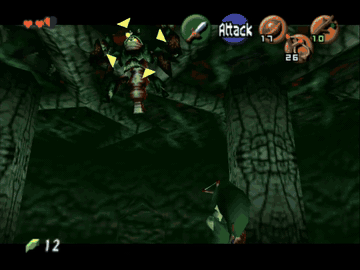
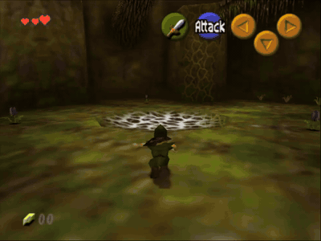

# ppo-hyrule

**The Legend of PPO: learning to fight in Hyrule.** Reinforcement learning agents that play *The Legend of
Zelda: Ocarina of Time* in an unmodified Dolphin emulator, reading the game's **live memory** instead of
pixels: every actor's position, velocity, health and decoded animation routine, zero-copy, about 25
microseconds per step.

<p align="center">
  
  
</p>
<p align="center">
  <b>Queen Gohma, full fight:</b> <a href="https://youtu.be/FBD1wEsdY3E">youtu.be/FBD1wEsdY3E</a> (3m11s, uncut) ·
  <b>Deku Babas:</b> <a href="https://youtu.be/fMMvd1HmMjI">youtu.be/fMMvd1HmMjI</a> (27s, uncut)
</p>

The clips above are smash cuts. The YouTube links are the **unedited episodes**, and each has an
`attempts.json` beside it recording every attempt, won or lost, so neither is read as a typical episode.
The Gohma fight took four attempts at a start the policy wins 10.53% of the time.

[**Paper**](paper/paper.md) · [**Claim audit**](paper/CLAIMS.md) · [**Provenance**](PROVENANCE.md) ·
[**Artefact register**](artifacts/MANIFEST.json) · [**Repo map**](docs/MAP.md) ·
[**Models on Hugging Face**](https://huggingface.co/jordykieto/ppo-hyrule) ·
[**Data on Hugging Face**](https://huggingface.co/datasets/jordykieto/ppo-hyrule-data)

**The policies are in this repository**, under `checkpoints/kept/`, because the paper's claims cannot be
re-tested without them and each is under 10 MB. The 127 MB world model is on
[Hugging Face](https://huggingface.co/jordykieto/ppo-hyrule) along with copies of everything else, since it
exceeds what belongs in git history. Match by md5 from
[`artifacts/MANIFEST.json`](artifacts/MANIFEST.json), never by filename: four world-model checkpoints exist
in our own remote storage under the same names as different, earlier runs.

---

## What it does

| | |
|---|---|
| **Melee combat: solved.** | Three Deku Babas, cleared from 10 of 10 start states with 0 deaths. 78% success fleet-wide over 41.8 M environment steps, for **$51 and 4 h 52 m** on twenty CPU machines. |
| **A dungeon boss: not solved, and the interesting part.** | Queen Gohma defeated on **8.33% of 456 held-out episodes**, 3.53 of her 10 health taken. The rate ranges from **28.95% to 0 of 76** across six start states, ordered by how much of the fight the start hands the agent. |
| **100 human victories did not help.** | A clone of them reaches 74.5% next-action accuracy and 0.33 of 10 health, 1 win in 80. Fifteen ways of folding the demonstrations into the policy gradient produced **no improving arm**. |
| **A learned world model did not help.** | 120 epochs ends further from "nothing changes" than it started, and shuffling the action changes its prediction by a factor of 1.00. Policies dreamed inside it won **0 of 607** real episodes. |
| **One representation result clears its controls.** | A masked-prediction objective over the raw 363-field state beats both an untrained network of the same architecture and a free-signal control on **9 of 10** frozen probes. One seed. |

The boss result is worth one more line, because it is the part that is hard to see from the percentages.
Gohma takes damage only while stunned, and a stun has to be manufactured. A kill is ten such openings. Under
the credit horizon these runs used, the +60 for killing her reaches the first decision of an episode at
**0.000% of face value**, so everything the policy knows about assembling that chain, it learned from local
shaping with effectively no gradient from the outcome.

## Watch it

| clip | what it is |
|---|---|
| [Deku Babas (YouTube)](https://youtu.be/fMMvd1HmMjI) · [`media/deku-slot1/`](media/deku-slot1/) | the solved melee task end to end: the agent walks in from the room entrance, wakes all three Babas and clears the room. 26.7 s of game time, kills at 7.3, 22.4 and 26.8 s, first attempt. |
| [Queen Gohma (YouTube)](https://youtu.be/FBD1wEsdY3E) · [`media/gohma-slot5/`](media/gohma-slot5/) | a Gohma defeat from the full-health start, 10 of 10 health on the ceiling 347 units away. 191 s, ten sword hits, eight knockdowns of which it caused five, five larvae killed, two hearts lost. |

Each directory carries an `attempts.json` listing **every** attempt, won or lost, so a clip is never read as
a typical episode. That start wins 10.53% of the time, and all eight of its recorded wins kill larvae and take
all ten health, so the clip is representative of a win there and the attempt count says how often a win
happens.

```sh
scripts/record_wins.py --ckpt <policy> --slot N --slots-dir <dir> --out-dir media/<name> --wins 1
```

## The part that generalises

Measurement error exceeded method error in this project, and [paper.md section 9](paper/paper.md) is the
write-up. The short version:

- **A defeat is a 1 to 10% binary.** Read through it, six consecutive versions looked flat and two experiments
  were launched to break the apparent plateau. Read through boss damage, the graded quantity the reward pays
  for, the same runs rose **8.7 times** with every step statistically solid. One of the experiments launched to
  fix the plateau measurably caused one.
- **A rate averaged over start states you choose is not a property of the policy.** One version's apparent
  momentum was a single start at 50% curriculum weight while nine starts sat at exactly zero for 37 updates.
- **A selector needs resolution before it selects anything.** A checkpoint chooser ranking on 16-episode
  subsets at a 1.68% base rate was picking one lucky win in sixteen, which any checkpoint produces one time in
  five.
- **The maximum of N noisy estimates is biased upward.** A 12-cell grid's winner read +32%; confirmed at
  matched sample size it is +0.065 ± 0.117.
- **The noise floor is measured, four independent ways**, and two groups of three identical runs differ at
  t = 2.1 while being pure seed noise.

Nine claims this project published and then overturned are in [paper.md section 12](paper/paper.md), with the
control that killed each one.

## Layout

| path | what |
|---|---|
| `zelda_rl/` | emulator control, live memory attach (macOS mach / Linux shm), the shared state layout, observations, the combat task and its reward, PPO |
| `scripts/` | training, collection, evaluation, probes, `play.py` to watch a policy, `record_wins.py` to film one |
| `fleet/` | `python -m fleet`: create, bootstrap, preflight, launch, audit, sync, kill across cloud machines |
| `paper/` | [the paper](paper/paper.md), [the claim audit](paper/CLAIMS.md), and superseded drafts kept with their retractions |
| `docs/` | 21 documents; start at [MAP.md](docs/MAP.md), which says which one to read for a given task |
| `results/` | exported run histories and per-episode evaluation rows. Training histories are exported, never linked |
| `media/` | clips, each with the full attempt manifest beside it |

## Quick start (macOS)

```sh
scripts/setup_macos_memaccess.sh     # one-time: a code-signed Dolphin copy and interpreter
aws s3 sync s3://zelda-rl/zelda/combat/deku-baba/states/ datasets/zelda/combat/deku-baba/states/ --profile race-wm

DOLPHIN_BIN=~/.cache/zelda-rl/Dolphin.app/Contents/MacOS/Dolphin \
  .venv/bin/python-dbg scripts/play.py checkpoints/kept/deku-combat-gru-v2b-20p_u00120.pt \
    --slots-dir datasets/zelda/combat/deku-baba/states --slot 1
```

Attaching to emulator memory on macOS needs the code-signed interpreter `.venv/bin/python-dbg`; plain
`python` fails. Linux needs nothing special. Game data (savestates, NAND, ROM) is never committed.

Two traps that have each cost a session and are now checks rather than advice: **pin torch to one thread
before opening an emulator**, or it takes every performance core and the emulation thread stalls; and the
per-task savestate directory is **not** the live Dolphin slots, which hold whatever task was built last.
Pointing a policy at the wrong set does not crash, it silently reports every episode as a timeout.

## Reading the numbers

Every claim in the paper carries an evidence class in [CLAIMS.md](paper/CLAIMS.md) and traces to an artefact
in [PROVENANCE.md](PROVENANCE.md). Artefacts are identified by md5 in
[artifacts/MANIFEST.json](artifacts/MANIFEST.json), not by filename, because four world-model checkpoints
exist in remote storage under the same filenames as the ones cited and are a different, earlier run.

`AGENTS.md` is the working agreement for this repository: every rule in it exists because breaking it cost
real time, and the specific incident is named so the rule cannot be argued away as generic advice.
