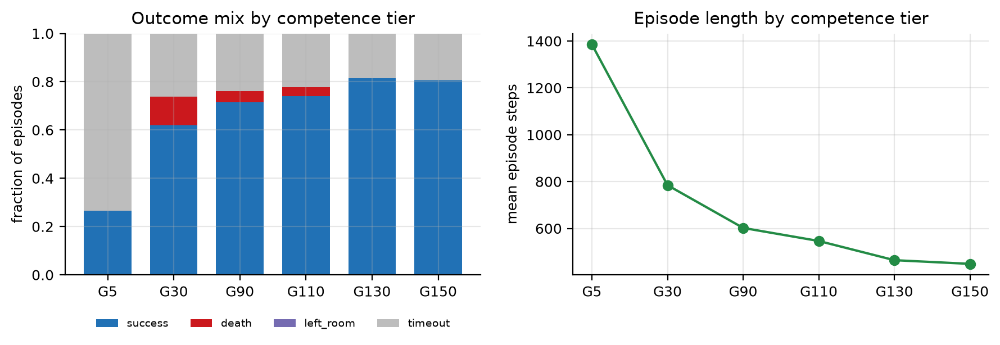

# Dataset card: Deku Baba structured-state transitions

Transitions `(state_t, action_t, state_{t+1})` over **structured game state** — not pixels — for the Deku
Tree first-room combat task. Built to train a transition (world) model that policies can then be optimised
inside; see [`../../../paper/paper.md`](../../../paper/paper.md) §5–6.

**Released run: `20260918-134229`** — 168 episodes, 109,817 transitions, 17 MB.

Mirrored at `s3://zelda-rl/zelda/combat/deku-baba/transitions/20260918-134229/` (private bucket, aws profile
`race-wm`). The frozen encoder trained on it is at
`s3://zelda-rl/zelda/combat/deku-baba/encoders/bc-decode-final.pt`.

## Composition

Episodes are replayed from six checkpoints along the model-free PPO training curve, so the data spans
competence tiers rather than expert behaviour only. A model trained on expert data alone never sees the
states a learning policy actually visits.

<!-- regenerate: .venv/bin/python results/make_figures.py -->

| Checkpoint | Episodes | Transitions | Success | Death | Timeout | Mean episode steps |
|---|---|---|---|---|---|---|
| G5 | 15 | 20,782 | 27% | 0% | 73% | 1385 |
| G30 | 42 | 32,949 | 62% | 12% | 26% | 784 |
| G90 | 21 | 12,644 | 71% | 5% | 24% | 602 |
| G110 | 27 | 14,751 | 74% | 4% | 22% | 546 |
| G130 | 27 | 12,539 | 81% | 0% | 19% | 464 |
| G150 | 36 | 16,152 | 81% | 0% | 19% | 449 |
| **Total** | **168** | **109,817** | **69%** | **4%** | **27%** | 654 |

All ten start slots are covered. G150's 81% is consistent with the 77% measured during fleet training
(`docs/COMBAT_TASK.md`), which is the check that the replay harness reproduces the policies faithfully.



## Layout

```
20260918-134229/
├── dataset.json        # schema, field names, action names, per-checkpoint totals
├── manifest.jsonl      # one row per episode: outcome, kills, HP, checkpoint, slot, steps
└── episodes/
    └── ep00001_G150_s01_success.npz
```

Each `.npz` holds, for an episode of `T` decisions:

| Array | Shape | Notes |
|---|---|---|
| `action` | `(T,)` int64 | index into `dataset.json["action_names"]` |
| `reward` | `(T,)` float32 | task reward, `zelda_rl/combat.py` |
| `state` | `(T+1, 335)` float32 | **T+1** — the reset state plus one per step |
| `obs` | `(T, 483)` float32 | the policy's own observation, for reference/BC baselines |

**Transition `t` is `(state[t], action[t], state[t+1])`.**

## State encoding (335 dims)

| Block | Dims | Fields |
|---|---|---|
| Link | 15 | scene, room, hp, hp_cap, sf1, pos (3), yaw, targeted_row, arrow_row, held_item, seeds, nuts, grass |
| Actors | 16 × 20 | present, id, hp, pos (3), fn_rel, state_idx, shape_yaw, yaw_to_player, timer, cat, params, yaw, vel (3), focus (3) |

Two properties the encoding guarantees, both of which a dynamics model depends on:

- **Rows are permutation-stable within an episode.** An actor claims a row on first sight and keeps it until
  the episode ends, so row *j* at *t* and *t+1* is the same entity. `present` goes 1→0 when it despawns.
- **No memory addresses.** Lock-on (`targeted_row`) and Navi's target (`arrow_row`) are stored as row
  indices, `-1` for none.

`state_idx` indexes `dataset.json["baba_states"]` — the Deku Baba's decoded action routine (`hidden`,
`prepare_lunge`, `lunge`, `pull_back`, `stunned`, `dying`, …). This is the behavioural signal the policy
keys on and the hardest thing for a dynamics model to get right, so evaluate it separately.

Actor ids present: `0x0055` Deku Baba (the targets), `0x0095` and `0x0037` (room props/other actors, carried
so the model sees the full scene). Start states hold at most 9 actors; 16 rows leaves headroom for
mid-episode spawns. **0 actors were dropped** across the released run.

## Actions

63 discrete: 9 stick directions × 7 button combinations. Directions are **world-frame** angles, which the
environment converts to a stick deflection using the camera yaw — so action and state share one frame.
Names are in `dataset.json["action_names"]` (`-`, `NW+Z+B`, `E+Shield`, …). Decisions at **10 Hz**
(`vi_per_step: 6`); this is the transition Δt and must not be changed without recollecting.

## Reproduce

```sh
# start states (the live Dolphin slots hold Gohma states -- do not use them)
aws s3 sync s3://zelda-rl/zelda/combat/deku-baba/states/ datasets/zelda/combat/deku-baba/states/ --profile race-wm

DOLPHIN_BIN=~/.cache/zelda-rl/Dolphin.app/Contents/MacOS/Dolphin \
  .venv/bin/python-dbg scripts/collect_transitions.py --transitions 100000 --workers 10
```

17.6 min on an 8-core laptop, ~104 steps/s across 10 headless Dolphin instances. Episodes run independently
rather than in lockstep; lockstep costs roughly half the throughput at ten instances because every tick
waits on the slowest.

The collector **refuses to start** unless each start state contains a live Deku Baba, and prints the count
per slot. This guard exists because the first collection run silently produced a worthless dataset: the live
Dolphin slots had been overwritten with Queen Gohma savestates, so the policy was fighting the wrong enemy
and every episode ended as a zero-target timeout — indistinguishable from a weak policy in aggregate.

## Known limitations

- **On-policy to one training run.** Coverage is six tiers of a single PPO run, not the space of behaviours.
  States reachable only by a differently-shaped policy are absent.
- **Timeout-heavy tail.** 27% of episodes hit the 180 s cap and contribute 1800 steps each, so transitions
  are over-weighted toward stalled fights. Weight or subsample by episode if that matters.
- **Reward is task-specific.** The `reward` array reflects `CombatConfig` at collection time
  (`dataset.json["checkpoints"]` pins the policies, but reward weights live in `zelda_rl/combat.py`).
  A dynamics model should predict *state*; re-derive reward from predicted state rather than trusting this
  column across reward changes.
- **Split is by start slot, three ways**, fixed in `scripts/train_bc_decode.py`: train {1,2,3,5,6,10},
  threshold-tuning {4,8}, test {7,9}. Consecutive frames are near-duplicates, so a random split leaks badly;
  slots 7 and 9 are also among the hardest in training (32%/41% success), which makes the test split
  conservative.
